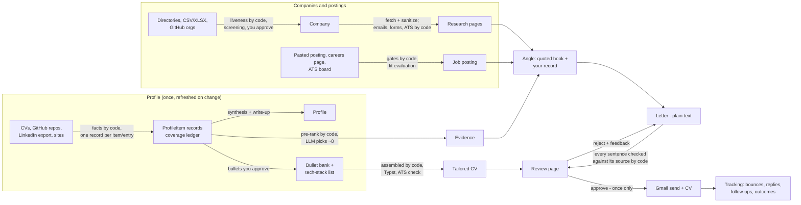
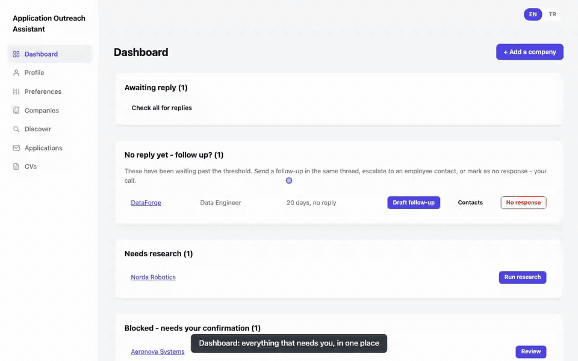

# Application Outreach Assistant

Personal tool for job-application outreach to tech companies (primarily Ankara):
finds companies and job postings, researches each one, writes tailored
applications and one-page CVs that cite their sources, sends only what you
approve, tracks every application, and escalates to individual employees when
a company doesn't respond. Rules and design in [CLAUDE.md](CLAUDE.md); phase
specs and status in [docs/ROADMAP.md](docs/ROADMAP.md).

## How it works

**Problem:** cold applications to dozens of small tech companies are either
generic (and ignored) or take an evening each to research and write.
**Approach:** the app does the reading - your background once, each company's
site and each posting per application - and drafts a letter and a CV that cite
both sides. Code does everything that doesn't need language understanding
(detection, filtering, checking); the LLM only does what's left, and code
checks its work. You approve every send.



FastAPI + Jinja2 UI on localhost, SQLite, a provider-agnostic LLM layer (Claude
or Gemini - a cheap model for reading, a stronger one for anything a company
reads), Gmail API for sending, Typst for CVs.

## How it keeps the LLM honest

Hallucination is handled by code, not by asking the model nicely. What the app
enforces:

- **Retrieval is the app's.** The model never browses. Pages are fetched,
  sanitized (hidden text, invisible characters, instruction-shaped lines) and
  fenced as untrusted in every prompt.
- **Ids and URLs are checked.** A source URL that wasn't fetched, or a record
  id that wasn't offered, is dropped and shown to you.
- **Quotes are checked.** Repo results, angles, posting-fit reasons,
  preference flags, reviewer notes and captured facts each carry a quote that
  must be found in its source; otherwise they're dropped or marked unverified.
- **Every letter sentence is checked.** A metadata call maps each sentence to
  the source and the words that state it; code looks the quote up in that page
  or record. A company claim needs a page quote, a claim about you a record
  quote; a sentence the model calls "nothing to verify" is still checked when it
  looks factual (numbers, technologies, the company's name). Unsupported
  sentences are listed in "check before sending". After you edit the letter the
  check is marked stale until you re-run it.
- **Model text is not reused as fact.** The research summary reaches later
  prompts only sentence by sentence, when each sentence carries a quote found on
  the site; open positions only when their title is on a page. In profile
  records, role angles and talking points are labelled "model framing" and only
  shown to the writer when their numbers and technologies are in the facts and
  they make no unbacked "led / production / users" claim. Only verified results,
  code facts, your own words and verbatim CV text count as citable.
- **Facts are computed, not generated.** Stacks come from manifests and
  imports, maturity from the file tree, commit share from history; numbers and
  technologies in letters and CV bullets that aren't in the sources are flagged.
- **Measured with a trap eval.** `scripts/hallucination_eval.py` runs the real
  drafting pipeline on six trap cases (`app/evals/cases/hallucination.json`): a
  technology you don't have, a project without a metric, a model-written
  "deployed for 500 users" angle, a research summary claim no page makes,
  company facts the site never states, inflated experience. Each letter is
  scored by code - trap patterns (fabrications), unsupported sentences,
  ungrounded numbers/technologies, stock phrases - and the report lands in
  `data/evals/`. It uses your draft model, so it costs money (about three calls
  per case); each case runs in its own in-memory database. The pytest suite
  checks the eval itself with fake models (an honest letter passes, a
  fabricating one is caught).
- **What isn't covered:** paraphrase is only checked through quotes - a sentence
  can be supported by a quote yet overstate it - and the synthesized profile
  summary isn't verified yet. You remain the reviewer.

## Demo



Recorded on the v1 UI (before job postings, the CV builder and the newer
checks). A walk through it, in order:

1. **Dashboard** - the queues that need you.
2. **Profile and preferences** - your background with its sources, and the
   dealbreakers every company is checked against.
3. **Discover** - a technopark directory is imported, every homepage is
   screened (what they do, fit, dealbreakers with the words from their site),
   and ✓ / ✕ decide each candidate; a company without a listed website gets a
   Google search link.
4. **A company** - added by hand, its website researched right away.
5. **A draft** - AI notes on the position and CV it picked, a letter built on
   real projects, and the profile evidence it used.
6. **Feedback** - "shorter, lead with etl-pipeline" and the letter is rewritten.
7. **Approve** - sent once, with the chosen CV, then tracked.
8. **A dealbreaker** blocking drafting, the **applications** history, and the
   **follow-up** queue for companies that haven't replied.

Everything in it is fictional demo data (`*.example` addresses, a made-up
"Demo Teknokent"), recorded against a throwaway database with the LLM, Gmail
and the web stubbed out - nothing was sent. How to re-record:
[scripts/demo/README.md](scripts/demo/README.md).

## Status

All of v1 plus roadmap phases 0-7 are built (`docs/ROADMAP.md`). By area:

- **Profile** (`/profile`): CV / LinkedIn export / GitHub / site ingestion with a
  coverage ledger. CVs and LinkedIn exports become one record per role, project
  or education entry with the bullet text verbatim. GitHub repos get facts
  computed by code (dependencies from manifests, tests, CI, deployment files,
  your share of commits), code the app picks and the model only ranks by path,
  and a rich record written by the draft model and verified by code. "Check for
  changes" makes no LLM call; re-analysis of a changed repo is shown as a diff
  and never overwrites what you edited. Each record has questions only you can
  answer; your answers count as evidence. Hierarchical synthesis (no record is
  ever cut off) and a long, editable "about me" write-up.
- **Preferences**: hard/soft constraints checked against every company and
  posting, keyword pre-screen by code, evidence on the page it's actually on.
  Letter language and your identity block (read from your CV; type only to
  override) are set here.
- **Companies**: manual and bulk add; research fetches home, careers, about,
  contact and job pages, finds emails (footer, `mailto:`, Cloudflare,
  `[at]`), forms and ATS boards in the raw HTML, and reuses the previous AI
  summary when the site text hasn't changed.
- **Discover** (`/discovery`): technopark directories, CSV/XLSX lists, JSON
  endpoints of JavaScript-only directories and GitHub organizations; a no-LLM
  liveness check skips dead sites before any screening call. See
  [Discover companies](#discover-companies).
- **Job postings** (`/postings`): paste a URL or text (LinkedIn links through
  the LinkedIn MCP rule below), read ATS boards (Greenhouse, Lever, Ashby,
  SmartRecruiters) with a Turkey location filter, or let the careers-page watch
  find new ones (robots.txt respected, LLM only when a page changed). Gates by
  code (location, experience, language), fit with quotes, legitimacy flags,
  expiry check before drafting. Board discovery uses Tavily search, only to find
  board slugs.
- **Drafting and review**: angle (a quoted company hook + one of your records)
  -> the letter as plain text on the draft model -> a metadata call, with style
  rules and examples, recipient-aware tone and an app-written signature and
  portfolio link. "Check before sending" lists unsupported sentences, numbers
  and technologies not in the sources, stock phrases and length; a reviewer
  pass on the draft model suggests edits you apply one by one. Facts you state
  in feedback or edits are proposed for your profile.
- **CV builder** (`/cv-builder`): projects suggested from your records, 3-6
  bullets each that you approve (numbers checked against the record), a tech
  list with where each skill is used, and a one-page CV assembled by code for
  each application in your current CV's layout (Lato, Typst). Education and
  experience are copied verbatim; missing posting keywords are reported, never
  added. The PDF's text layer is checked like an ATS would read it.
- **Sending and tracking**: Gmail with validation, dedup and a send delay, a
  snapshot of the exact CV attached, protection against a double send on a
  timeout; bounces, auto-replies and replies told apart, with "possible reply"
  notes from the company's domain; same-thread follow-ups; employee escalation;
  form applications you submit yourself and then track.
- **Outcomes and cost**: `/funnel` (reply and interview rates, time to reply,
  by source / channel / CV / language / angle), `/costs` (every LLM call with
  tokens and estimated cost), `/style` (standing writing rules and examples).
- **LinkedIn research** (optional, off by default) - see
  [LinkedIn research](#linkedin-research-optional).
- EN/TR interface; 367 passing tests (`tests/`).

**To actually use it**, pick a provider in `.env` (`LLM_PROVIDER=gemini` or
`claude`) and set that provider's API key - everything that calls the LLM
(ingestion extraction, preference checks, research, drafting) needs it. Without
a key those routes fail on a friendly error page rather than doing anything
silently wrong. Gmail send/reply-check additionally need `credentials.json`
(OAuth client, see CLAUDE.md section 5) and `GMAIL_SENDER_ADDRESS`; `token.json`
is created on first send. ATS board search needs a Tavily key
(`SEARCH_API_ENABLED=true`, `SEARCH_API_KEY`, free credits at app.tavily.com).
CV rendering needs nothing beyond `requirements.txt` (the Typst compiler ships
in the `typst` wheel, Lato is bundled). **Publish the OAuth app** (Google Cloud Console ->
OAuth consent screen -> "In production"): while it is in "Testing", Google
expires the token after 7 days and sending and reply checks stop with
`invalid_grant` - delete `token.json` and approve again to recover.

## Setup

```bash
python3 -m venv .venv
source .venv/bin/activate
pip install -r requirements.txt

cp .env.example .env
# set LLM_PROVIDER and the matching key:
#   gemini -> GEMINI_API_KEY (Google AI Studio)
#   claude -> ANTHROPIC_API_KEY (letters use ANTHROPIC_DRAFT_MODEL, Sonnet by default)
```

## Run

```bash
source .venv/bin/activate
uvicorn app.main:app --reload --port 8000
```

Open http://127.0.0.1:8000 - localhost only, no auth (single-user tool). Use the
venv's interpreter: dependencies (including the MCP client the LinkedIn research
uses) are installed there, not in the system Python.

Tables are created automatically on first startup (`data/app.db`); schema changes
to existing tables are applied as safe, additive `ALTER TABLE` migrations in
`app/db.py` - existing data is never touched or rebuilt.

Suggested first run: **CVs** (add at least one variant) -> **Profile** (ingest
your CV, GitHub repos and portfolio, answer the record questions, synthesize,
review) -> **Preferences** (constraints, letter language, portfolio URL) ->
**CV builder** (suggest projects, approve bullets, import your skills, render a
sample and approve the template once) -> **Discover** / **Companies** /
**Postings** -> **Dashboard** (start an application, review, tailor a CV,
approve & send).

## Discover companies

The **Discover** page turns technopark company directories into candidates you
approve one by one:

1. **Import** a directory. Five Ankara directories are built in, each read
   from its own structure (no LLM): ODTÜ Teknokent (the data file behind its
   JavaScript page), Bilkent Cyberpark (paginated cards with sector), Hacettepe
   Teknokent (sector categories -> company pages with website and email),
   OSTİM Teknopark (company pages with website and email) and Ankara
   Üniversitesi Teknokent (its sitemap -> company pages) - about 1,500
   companies together. Any other directory page can be added by URL with its
   city and technopark name; its text and links are read by the LLM and a
   website is only kept if the page actually links to it. A JavaScript-only
   directory (e.g. Gazi Teknopark) is added by the JSON endpoint you see in the
   browser's network tab, with a field mapping - read by code. A CSV/XLSX list
   you downloaded (e.g. the ministry's Ar-Ge merkezi list) is imported with a
   column mapping, and GitHub organizations can be listed by location.
   Companies already in your list are recognised even under a legal name or a
   sister domain ("3DTİM ELEKTRONİK A.Ş." / beevision.ai = your BeeVision),
   hidden as "already in my list", and their empty city/technopark/email
   fields get filled in. Anything you rejected before is never suggested again.
   A candidate the directory lists without a website gets a "Search on Google"
   link (brand or listed name + technopark); paste the site you find and it
   goes back into the screening queue.
2. **Check liveness** (no LLM): DNS, HTTP status, parked or placeholder pages,
   and how recent the newest copyright year, sitemap date or news post is -
   ALIVE / STALE / DEAD / UNKNOWN, with the evidence. Dead sites are skipped by
   screening unless you include them.
3. **Screen homepages** - preference keywords are matched by code first, then
   one small LLM call per company:
   what it does in one sentence, how well it fits your target roles, whether
   the site has a careers page, and any preference conflict (e.g. defence) with
   the words on the site that triggered it. Runs one company per page refresh;
   leave the page to stop, come back to continue.
4. **Approve or reject** from a table sorted by fit. Approved companies join
   your list under their brand name (the directory's legal name goes into the
   notes), tagged with city and technopark, and wait in the dashboard's "needs
   research" queue - no research call is spent until you get to them.

## LinkedIn research (optional)

Off by default. When enabled, each company page gets a LinkedIn card: how many
people LinkedIn actually lists (not the company's own size bracket, which is a
much larger number on most company pages), a breakdown of what they do, whether
the company has posted recently, the openings LinkedIn lists next to what their
own careers page said, and the people worth contacting. Those people flow into
the same confirm-before-it-counts table as site-found contacts; LinkedIn never
exposes email addresses, so they stay un-escalatable until you fill one in.

Decision-makers don't appear on the unfiltered employees page, so research also
searches that page for each term in `LINKEDIN_PEOPLE_KEYWORDS` (`CEO,CTO,müdür,
insan kaynakları,HR,founder` by default) - the same thing as typing them into
the people tab's search box. People whose title names a different employer are
dropped. Each term costs one more page load: shorten the list to go faster, or
empty it to skip the targeted search.

The company's LinkedIn URL is picked up automatically from the LinkedIn icon on
their own website during normal research. For companies added before that
existed, the card has a paste box and a "look for it on their website" button
that re-reads just their social links - no LLM, no LinkedIn traffic.

**Use a throwaway LinkedIn account.** This drives a real browser session, which
LinkedIn's terms forbid and which can get an account restricted. That is why the
feature is opt-in, runs one company per click (never on add, never in bulk), and
only ever reads company pages - it does not message anyone or send connection
requests. With the flag on, a LinkedIn job link pasted on the Postings page is
read through the same server and account, one posting per click.

```bash
# 1. install uv (provides uvx): https://docs.astral.sh/uv/getting-started/installation/
# 2. log the throwaway account in once - the session persists under ~/.linkedin-mcp/
uvx mcp-server-linkedin@latest --login
# 3. in .env:
#    LINKEDIN_RESEARCH_ENABLED=true
```

The server is [stickerdaniel/linkedin-mcp-server](https://github.com/stickerdaniel/linkedin-mcp-server),
published as `mcp-server-linkedin` (`linkedin-mcp-server` on PyPI is an
unrelated project). Keep the `@latest` tag - LinkedIn changes its page structure
often, and a pinned version quietly starts returning empty data.

A run takes a few minutes (a real browser loading eight LinkedIn pages) and the
request blocks for that long on purpose - it is one owner-triggered action, not
a background job. If the session expires, the company page shows the error and
re-running `--login` fixes it.

## Security boundaries

This is a single-user tool meant to run on your own machine. What it assumes
and what it guards against:

- **Localhost only, no auth.** Don't expose the port; anyone who can reach it can
  send email as you.
- **Cross-site requests are refused.** Not exposing the port isn't enough on its
  own: any website open in your browser could submit a hidden form to
  `127.0.0.1` (say, rewrite a pending draft and then approve it). Every
  POST/PUT/PATCH/DELETE must prove it came from the app's own pages
  (`Sec-Fetch-Site: same-origin`, or a matching `Origin`/`Referer` on browsers
  that don't send it). Requests that can't prove this get a 403. Requests
  addressed to any host other than `127.0.0.1`/`localhost` are refused too,
  which blocks DNS-rebinding pages (`ALLOWED_HOSTS` in `.env`).
- **Every send is human-approved, exactly once.** The send path refuses anything
  that isn't awaiting approval or that already has a send timestamp or Gmail id,
  and claims the application with a conditional update before calling Gmail, so
  a double-click or a second tab can't send twice. A sent application can't be
  edited, regenerated, or moved back to a draft state by hand.
- **Scraped text is data, not instructions.** Before any page text reaches a
  prompt, the app strips what a visitor wouldn't see: hidden elements (`hidden`,
  `aria-hidden`, inline styles that hide text or push it off-screen), comments,
  `<template>`/`<svg>` text, zero-width and bidi control characters, and Unicode
  tag characters. Lines that read like instructions to an AI ("ignore previous
  instructions", "sen bir yapay zekasın") are flagged, and the company page
  shows a warning with the evidence when a site looks like it targets an AI
  reader. Website and LinkedIn text is also fenced as untrusted in every prompt,
  and the model is told never to follow instructions inside it. The app, not the
  model, decides which sources and profile records count.
- **Forms are never filled or submitted by the app.** Detected forms are shown
  with their fields; you apply yourself and mark it submitted.
- **External providers are opt-in.** LinkedIn research and Tavily search are off
  until enabled in `.env`; search only finds ATS board slugs, never postings.
- **Secrets stay local.** `.env`, `credentials.json` (Gmail OAuth client) and
  `token.json` (your Gmail token) are git-ignored and never leave the machine
  except to Google/the LLM provider.
- **URL fetching** only follows addresses you enter (and links on those sites).
  There is no private-IP/SSRF filter: with the owner as the only one entering
  URLs on their own machine, it isn't worth its complexity here - add one before
  ever exposing this to other users.
- **Uploads**: CV variants must be PDF/DOCX under 10 MB and are stored under a
  unique name, so two CVs never share or overwrite a file. The recipient sees a
  clean attachment name derived from the CV's display name.

## Test

```bash
source .venv/bin/activate
python -m pytest tests/ -v
# real-model hallucination eval (costs money; uses LLM_PROVIDER from .env)
python scripts/hallucination_eval.py --runs 3
```

LLM-dependent logic is tested against `tests/fakes.py` (`FakeLLMProvider`,
`SequencedLLMProvider`, and `RoutedLLMProvider`, which answers by which prompt
is asking) - no real API key needed. `tests/conftest.py` points the app at a
throwaway SQLite file and temp directories before any app module is imported,
forces the LinkedIn and reviewer flags off, refuses any real Gmail or LLM call
(a test must fake the seam it uses), so the suite never touches `data/`, never
sends anything and never depends on your own `.env`. HTTP fetches, the LinkedIn
MCP subprocess, ATS boards and the search API are faked at their module seams;
CV rendering runs the real Typst compiler and checks the real PDF.

## Layout

```
app/
  config.py            settings from .env (pydantic-settings)
  db.py                 SQLAlchemy engine/session, init_db(), additive column migrations
  models.py              entities + state machines (CLAUDE.md sections 6-7)
  main.py                 FastAPI app entrypoint, onboarding gate, cross-site guard
  llm/                    provider-agnostic interface, Gemini + Claude, call log + costs
  profile_builder/        ingestion (CV/LinkedIn entries, GitHub, sites), repo facts,
                           code-reading plan, rich repo records, change detection,
                           coverage ledger, synthesis, write-up
  preferences/             hard/soft checker, keyword pre-screen
  companies/                fetch, sanitizer, email extraction, budgeted context,
                             research workflow, bulk parsing, LinkedIn research
  channels/                  form / ATS / portal detection, registrable domains
  discovery/                 directory readers, CSV/XLSX/JSON/GitHub sources,
                              liveness check, screening, approval
  postings/                  intake, gates, fit, ATS boards, careers watch, search
  applications/              evidence, angles, letter + sentence checks, grounding,
                              style, signature, reviewer, facts, review/send,
                              reply check, follow-ups, escalation, outcomes
  cv_builder/                bullet bank, tech list, assembly, Typst template + fonts,
                              ATS check, consistency check
  evals/                     hallucination eval (trap cases + scoring)
  email_send/                Gmail OAuth2: send, thread classification, searches
  web/                       routes + Jinja2 templates + i18n + a little JS
scripts/                     DB init, Gmail smoke tests, hallucination eval, demo recorder
docs/ROADMAP.md              phase specs and status
tests/                       pytest suite (367 tests)
```
