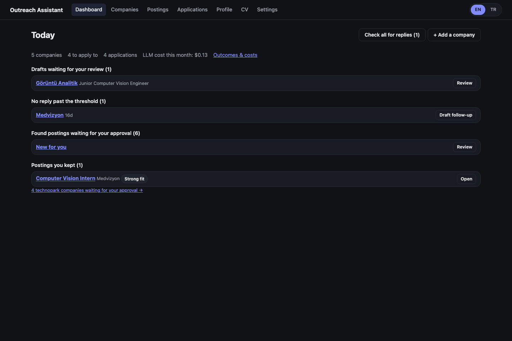
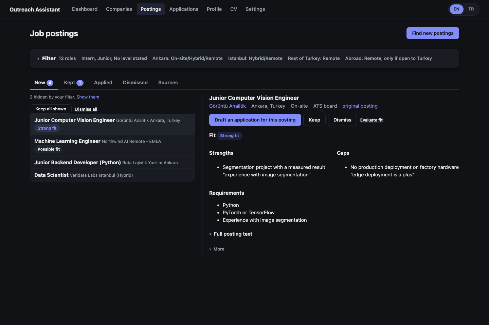
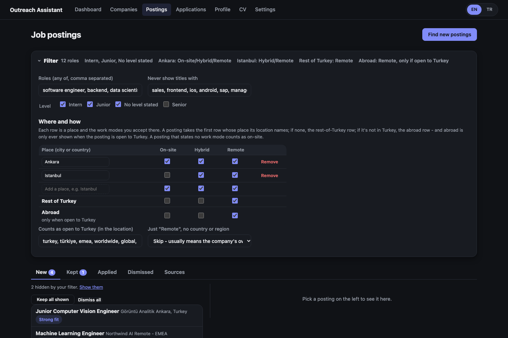
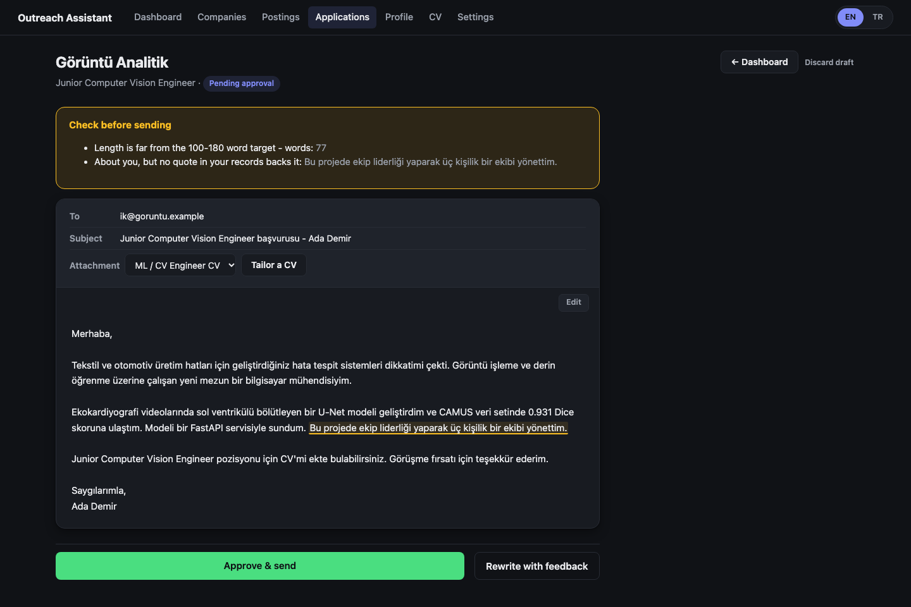
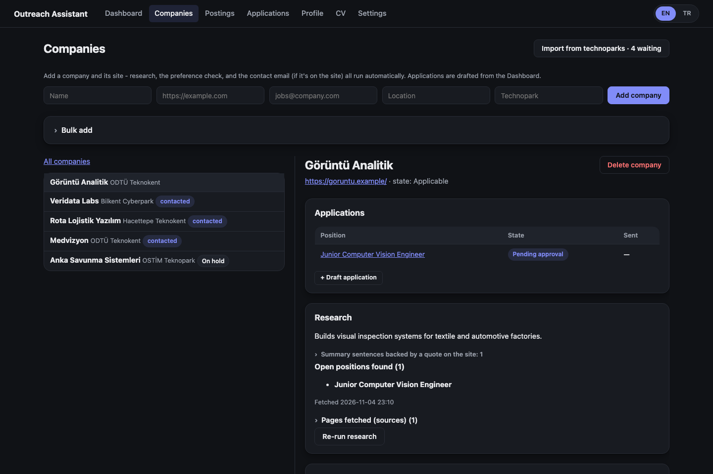
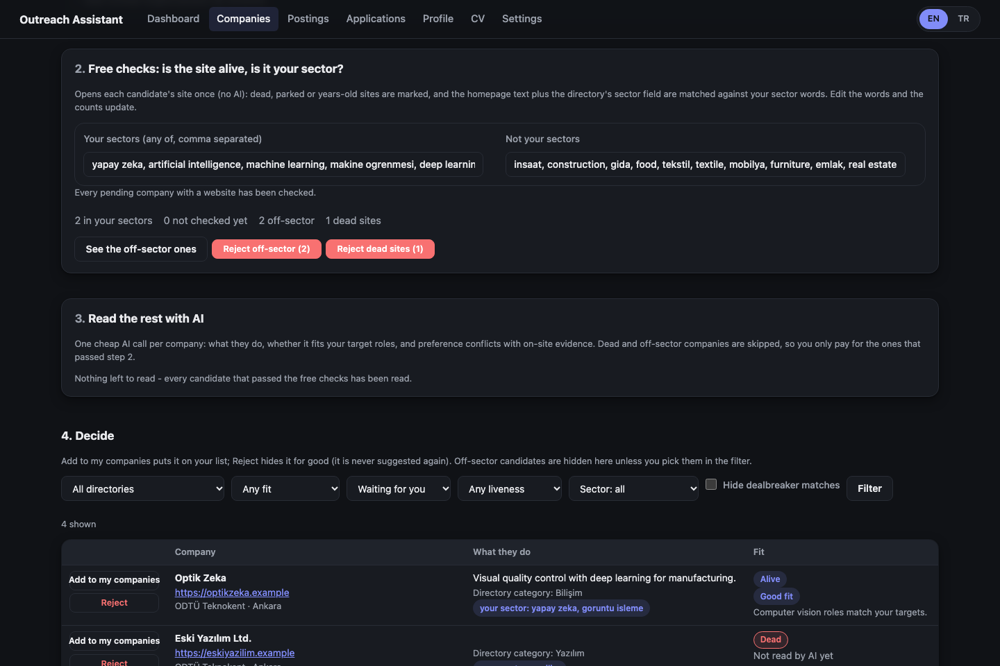
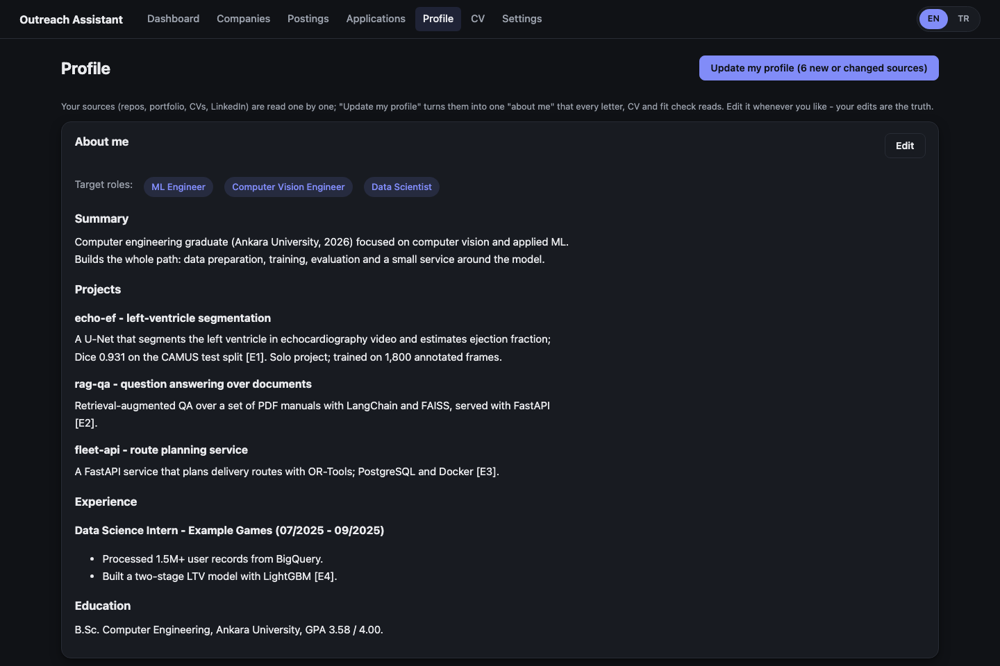
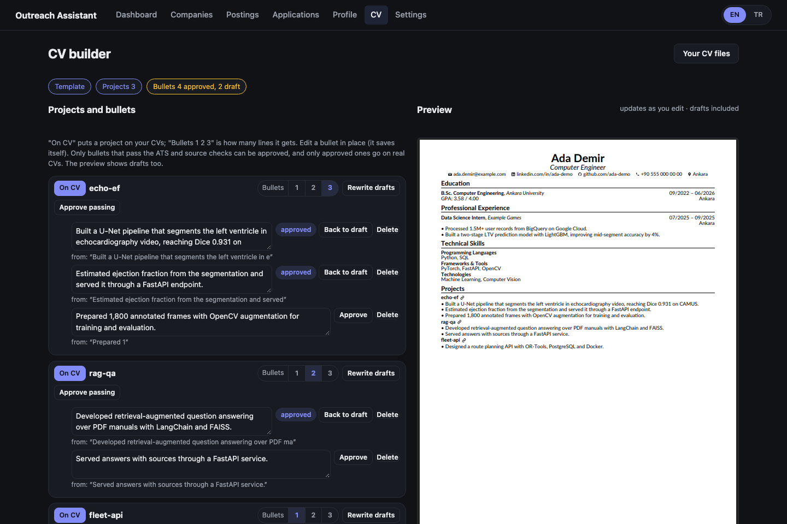
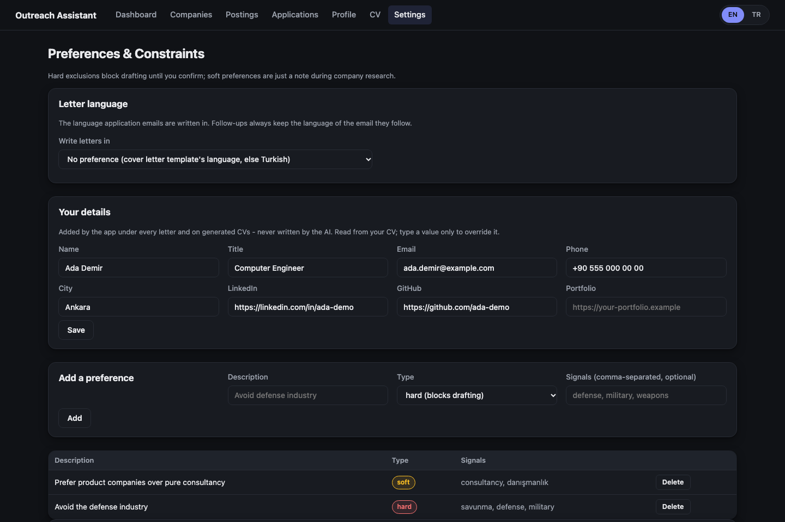
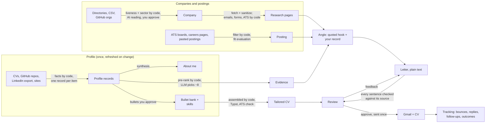

# Job Outreach Assistant

A personal tool for applying to tech companies (built for Ankara): it finds companies and postings, researches each one, writes a tailored letter and a one-page CV that cite their sources, sends only what you approve, and tracks every application.


**The problem:** cold applications to dozens of small tech companies are either generic, and get ignored, or take an evening each to research and write.
**The approach:** the app does the reading. It reads your background once, and each company's site and posting for every application. Then it drafts a letter and a CV grounded in both. Code does everything that doesn't need language understanding: detection, filtering, checking. The LLM only does what is left, and code checks its work. Nothing is sent without your approval.

## Contents

- [The app, page by page](#the-app-page-by-page)
- [Getting started](#getting-started)
- [How it works](#how-it-works)
  - [Architecture](#architecture)
  - [Design decisions](#design-decisions)
  - [How company research works](#how-company-research-works)
  - [How hallucination is kept out](#how-hallucination-is-kept-out)
  - [Problems worth knowing about](#problems-worth-knowing-about)
  - [Security boundaries](#security-boundaries)
- [Tests](#tests) · [Layout](#layout)

## The app, page by page

*The screenshots use fictional data: made-up people and companies with `*.example` addresses. They are regenerated with `python scripts/screenshots.py` against a throwaway database.*

### Today



The home page is one list of what needs you, most urgent first:
- drafts to review
- applications with no reply past the threshold
- postings waiting for your approval
- postings you kept
- companies ready for a letter
- companies that need research or a dealbreaker decision

Each row has one button. The bar above it shows counts and this month's LLM cost.

### Job postings



**Where postings come from:**
- public ATS boards (Greenhouse, Lever, Ashby, SmartRecruiters)
- your companies' careers pages, re-read only when their text changed
- a link or text you paste

Found postings wait under **New** until you keep or dismiss them. The list is on the left and the open posting on the right. Every action works without leaving the page: keep, dismiss, evaluate fit (with quotes from the posting), start an application. Boards, pasting and board search are in the **Sources** tab.



**The filter is yours to edit.** It is applied by code and saved as you type:
- **Roles:** with aliases. "ml" also matches "machine learning", "swe" matches "software engineer", and Turkish titles are recognised.
- **Excluded words** and **levels**.
- **Location rules:** a list of places, each with the work modes you accept there (Ankara: any; Istanbul: hybrid or remote), one row for the rest of Turkey, and one for abroad.

Abroad only counts when the posting is open to Turkey: its location names Turkey or a term you count as open (EMEA, worldwide …). "Remote - Canada" is out, and so is an EMEA role whose description says "must be based in Germany".

Boards import only matches; the rest are counted by the rule they missed ("48 read, 3 new, 30 other roles, 7 wrong level, 3 outside your location rule").

### Reviewing an application



The letter is shown as the company will see it.
- "Check before sending" lists what code could not verify, and each unverified sentence is highlighted inside the letter. In the screenshot, "I led a team of three" has no record behind it.
- Click the letter to edit it. **Approve & send** stays in view, and the attachment is chosen right there: the tailored CV or one of your files.
- **Rewrite with feedback** regenerates the letter from your note.
- The reasoning, the alternative angles, the profile evidence used and the sources sit in tabs below the letter.

### Companies



Companies are added by hand, in bulk or from technopark directories.
- **Research runs right away:** home, careers, about and contact pages, plus a few job pages.
- **Found by code:** emails, application forms and ATS boards.
- **From the LLM:** a short summary, with each sentence backed by a quote from the site, and the open positions.
- A company opens beside the list. Research, contacts and drafting all happen on the same page.

### Discovering companies



Directories become candidates you approve, in four steps:
1. **Bring companies in.** Five Ankara technoparks are built in (ODTÜ, Bilkent, Hacettepe, OSTİM, Ankara Üniversitesi), about 1,500 companies. You can also add any directory page, a JSON endpoint, a CSV/XLSX list or GitHub organizations by location.
2. **Free checks, no AI:**
   - Is the site alive? DNS, HTTP status, parked pages, the newest copyright year or sitemap date.
   - Is it your sector? Your sector words and the ones to avoid are matched against the directory's sector field and the homepage text.

   Dead and off-sector companies can be rejected in one click.
3. **AI reading**, only for the companies that passed: what they do, fit with your target roles, and preference conflicts with on-site evidence.
4. **Decide.** Approved companies join your list. Rejected ones are never suggested again.

### Profile



Your sources are read one at a time: CVs, GitHub repos, LinkedIn export and portfolio. **Update my profile** turns them into one "about me". That is the short summary and target roles that letters and fit checks read, plus a long document by project and role. You edit it in one place.

Repos rarely say your role, the team size or the real result, so the app asks: **questions only you can answer**. Answers become facts letters may claim, and skipped questions are never asked again.

One repo can be read or re-read on its own. Unchanged repos are never re-read.

### CV builder



Projects and bullets are on the left; the CV is re-rendered live on the right, in the layout of your current CV (Typst, Lato).
- **Bullets:** each project gets 1, 2 or 3 bullets, written broad rather than one per detail. A bullet can only be approved once code passes it: ATS rules (an action verb first, no first person, no symbols, length) and grounding (its numbers and technologies are in the record).
- **Skills:** ordered by importance. General ones go on every CV. Specific tools are added only when a posting asks for them.
- **Tailored CV:** made by code for every new draft. Education and experience are copied verbatim, and the PDF's text layer is checked the way an ATS reads it.

### Settings



Settings holds:
- letter language
- your details (read from your CV; type only to override)
- hard and soft preferences
- the optional cover-letter template
- the writing-style rules and examples every letter follows

Outcomes (`/funnel`) shows reply and interview rates by source, channel, CV and angle, and a log of every LLM call with its cost.

## Getting started

```bash
python3 -m venv .venv && source .venv/bin/activate
pip install -r requirements.txt
cp .env.example .env        # set LLM_PROVIDER (gemini | claude) and that provider's key
uvicorn app.main:app --reload --port 8000
```

Open http://127.0.0.1:8000. It is localhost only, with no login: a single-user tool. Tables are created on first start (`data/app.db`); later schema changes are additive `ALTER TABLE` migrations, so existing data is never rebuilt.

| Feature | Needs |
|---|---|
| Anything that calls the LLM | `LLM_PROVIDER` + `ANTHROPIC_API_KEY` or `GEMINI_API_KEY` |
| Sending and reply checks | Gmail OAuth `credentials.json` + `GMAIL_SENDER_ADDRESS`. Publish the OAuth app ("In production"); in "Testing", Google expires the token after 7 days. |
| ATS board search | `SEARCH_API_ENABLED=true` + a Tavily `SEARCH_API_KEY` |
| LinkedIn company research (optional) | `LINKEDIN_RESEARCH_ENABLED=true` + a throwaway account, see [below](#linkedin-research-optional) |
| CV rendering | nothing extra: the Typst compiler ships in the `typst` wheel and Lato is bundled |

Without a key, LLM routes fail on a clear error page rather than doing something silently wrong.

**A first run:**
1. **CV:** upload your CV file.
2. **Profile:** read your CV, repos and portfolio, answer the questions, then update the profile.
3. **Settings:** dealbreakers and letter language.
4. **CV builder:** approve bullets, then approve the template once.
5. **Companies / Postings:** add targets.
6. **Today:** review and send.

## How it works

### Architecture



- **One backend owns everything.** FastAPI serves server-rendered Jinja2 pages, and SQLAlchemy runs on SQLite. The backend makes every LLM call, fetches every page, renders CVs and sends mail. Nothing runs in the background; every action is a click.
- **The LLM sits behind one interface.** `LLMProvider.generate(prompt, system, json_schema=…)` is implemented for Claude and Gemini, and the factory is the only place that branches on the provider. Each provider has two models: a cheap **reading model** for research, extraction, checks and triage, and a stronger **draft model** for anything a company reads, plus the one-time repo records every later letter depends on.
- **Every call is logged** (`LLMCallLog`) with purpose, model, tokens and related ids, so cost is visible per company, per application and per month.
- **The UI is plain HTML forms made smoother with a little JS.** Lists, panes and filters swap in place. Without JS, every form still works as a normal post.

### Design decisions

- **Deterministic first; the LLM is the last and smallest step.** Every pipeline narrows with code before a model sees anything:
  - **Discovery:** dedup, then "rejected before", then liveness, then the sector words, and only then an AI read.
  - **Postings:** dedup by URL and content hash, then the filter, then fit.
  - **Profile:** an unchanged repo (same `pushed_at` and HEAD SHA) is never sent again.

  It is cheaper, it is predictable, and a rule you can read is easier to trust than a prompt.
- **The app decides what counts as a source, not the model.** The model can propose ids, URLs and quotes; code keeps only the ones that exist. This one rule carries most of the anti-hallucination design (below).
- **Prose and metadata are separate calls.** The letter is generated as plain text, so the model writes prose rather than filling a JSON field. A second, structured call annotates it: which source each sentence rests on, which CV fits. That annotation is what code checks against.
- **Two models instead of one.** Most calls are reading (research, extraction, checks), and a small model does that well. Only text a company reads, and the one-time repo records, go to the strong model.
- **SQLite with additive migrations.** It is a single-user tool, so there is no server to run. Schema changes only add columns, so a new version never touches existing data.
- **Typst for CVs.** It produces a real text-layer PDF from a template, deterministically, with no LaTeX install. The compiler ships as a Python wheel.
- **Human approval is a hard rule, not a setting.** There is no auto-send and no auto-submit. The app never fills or submits a form; it detects forms and leaves applying to you. Every CV bullet and every generated CV is approved by you.

### How company research works

1. **Fetch.** Home, careers, about and contact pages, plus up to three job pages linked from careers, all from the URL you gave or the directory listed. The app never guesses a website from a name and never uses a model's own web search. A careers link that goes to an ATS (Lever, Greenhouse …) is recognised by its host.
2. **Sanitize.** Hidden elements, comments, zero-width and bidi characters, and instruction-shaped lines ("ignore previous instructions", "sen bir yapay zekasın") are removed or flagged. The page shows a warning when a site looks like it targets an AI reader.
3. **Detect by code, from the raw HTML.** Emails: footer `mailto:`, Cloudflare-obfuscated addresses, `name [at] domain`; HR addresses are preferred. Application forms, with their fields. ATS boards and job portals. The company's LinkedIn link.
4. **Budget the context.** Pages go into the prompt by priority: job pages, then careers, about, home, contact. Each gets a share, so a long homepage can't crowd out a job posting. Text is never cut from a plain concatenation.
5. **One reading-model call.** It returns a summary with a quote for every sentence, the open positions, and the preference check with evidence snippets. Code keeps a summary sentence only if its quote is on a page, and keeps a position only if its title is. Each preference flag points at the page its snippet is actually on.
6. **Cache.** If the site text hasn't changed, the previous summary is reused, so a re-run costs nothing.

### How hallucination is kept out

This is enforced by code, not by asking the model nicely:

- **Retrieval belongs to the app.** The model never browses. Fetched text is sanitized and fenced as untrusted in every prompt.
- **Ids, URLs and quotes are checked.** A source URL that wasn't fetched, or a record id that wasn't offered, is dropped and shown to you. Repo results, angles, fit reasons, preference flags, reviewer notes and captured facts each carry a quote that must be found in its source.
- **Every letter sentence is checked** (`app/applications/claims.py`). The annotation maps each sentence to a source and the exact words that state it, and code looks those words up. A claim about the company needs a page quote; a claim about you needs a record quote. A sentence the model labels "nothing to verify" is still checked when it looks factual (numbers, technologies, the company name). Anything unsupported is highlighted in the letter. After you edit, the check is marked stale until you re-run it.
- **Model output is never reused as fact.** The research summary reaches a later prompt only sentence by sentence, and only where a sentence's quote is on the site. In profile records, model-written angles and talking points are labelled "model framing", never citable, and are dropped when they carry numbers or "led / production / users" claims the facts don't support. Only verified results, code-computed facts, your own words and verbatim CV text count as evidence.
- **Facts are computed, not generated.** The tech stack comes from manifests and imports, maturity from the file tree (tests, CI, deploy files), your share of commits from git history. Numbers and technologies in letters and CV bullets that appear in no source are flagged.
- **It is measured.** `scripts/hallucination_eval.py` runs the real drafting pipeline on six trap cases: a technology you don't have, a project without a metric, a model-written "deployed for 500 users", a summary claim no page makes, company facts the site never states, inflated experience. Each letter is scored by code. The eval found two real leaks, both fixed: angles laundered into citable text, and a false "your team" claim. It costs about three draft-model calls per case. The test suite checks the eval itself with fake models.
- **What isn't covered:** a sentence can be backed by a quote and still overstate it. That paraphrase gap is why you stay the reviewer.

### Problems worth knowing about

| Problem | What was done |
|---|---|
| A double-click or a Gmail timeout could send twice | Before calling Gmail, the send claims the application with a conditional update. A timed-out send is reconciled against the Sent folder instead of retried. |
| Contact emails sit in footers or are Cloudflare-obfuscated, so the extracted text never has them | Emails are found in the raw HTML by code, not by the LLM. |
| Readability picked one small card out of corporate homepages | It falls back to the full-page text when the "article" is too short, and is skipped on empty pages. |
| Some directories are JavaScript-only | They are read through the JSON endpoint they call, with a field mapping, by code. |
| Remote postings bound to another country flooded the list | Location rules per place, and abroad only when the posting is open to Turkey. |
| The PDF text layer split words, so an ATS saw "Py thon" | Typst kerning is turned off and hyphenated words are boxed. Every generated CV's text layer is checked with `pypdf`. |
| A website could hide instructions for an AI reader | A sanitizer runs before any prompt, an untrusted-content fence wraps every prompt, and a visible warning appears on the company page. |
| Re-reading 40 repos to pick up one change was slow and expensive | Change detection uses `pushed_at` + HEAD SHA. A changed repo is shown as a diff you review, and your own edits survive re-analysis. |

### Security boundaries

- **Localhost only, no auth.** Don't expose the port.
- **Cross-site requests are refused.** Any open website could otherwise post a hidden form to `127.0.0.1`. Every POST must prove it came from the app's own pages (`Sec-Fetch-Site`, then `Origin`/`Referer`). Requests addressed to other hosts are refused too, which blocks DNS rebinding.
- **Each send is human-approved, exactly once.** A sent application can't be edited, regenerated or moved back to draft.
- **External providers are opt-in.** LinkedIn research and Tavily search are off until enabled. Search only finds ATS board slugs; it is never a source of postings and never resolves a company's website.
- **Secrets stay local.** `.env`, `credentials.json` and `token.json` are git-ignored.
- **URL fetching** follows only addresses you entered and links on those sites. There is no SSRF filter, because only the owner enters URLs. Add one before exposing this to anyone else.

### LinkedIn research (optional)

Off by default. When enabled, a company page gets a LinkedIn card:
- how many people LinkedIn actually lists, and what they do
- recent activity
- listed openings
- people worth contacting

It runs through [stickerdaniel/linkedin-mcp-server](https://github.com/stickerdaniel/linkedin-mcp-server) (`uvx mcp-server-linkedin@latest --login` once) with a **throwaway account**: LinkedIn's terms forbid automated access, and the account can be restricted. That is why it is limited:
- one company per click, never on add and never in bulk
- it reads company pages only
- it never messages anyone or sends connection requests

## Tests

```bash
python -m pytest tests/                           # 390 tests, no API key needed
python scripts/hallucination_eval.py --runs 3     # real-model eval (costs money)
```

**The suite never touches your data or `.env`, and never sends anything:**
- It runs on a throwaway SQLite file and temp directories.
- The LLM is faked with `tests/fakes.py`: fixed answers, sequenced answers, or answers routed by which prompt is asking.
- Gmail, HTTP, ATS boards, LinkedIn and search are faked at their module seams, and `tests/conftest.py` refuses any real Gmail or LLM call.

CV rendering runs the real Typst compiler and checks the real PDF.

## Layout

```
app/
  llm/              provider interface, Claude + Gemini, call log + costs
  profile_builder/  CV / LinkedIn / GitHub / site ingestion, repo facts, change detection, synthesis
  companies/        fetch, sanitizer, emails, budgeted context, research, LinkedIn research
  channels/         form / ATS / portal detection
  discovery/        directory readers, CSV/JSON/GitHub sources, liveness, sector filter, AI reading
  postings/         intake, filter + location rules, fit, ATS boards, careers watch, search
  applications/     evidence, angles, letter + sentence checks, review/send, replies, follow-ups
  cv_builder/       bullet bank, skills, assembly, Typst template + fonts, ATS check
  preferences/      hard/soft checker, keyword pre-screen
  evals/            hallucination eval
  email_send/       Gmail OAuth2
  web/              routes, templates, i18n (EN/TR), a little JS
scripts/            screenshots, hallucination eval, Gmail smoke tests
docs/               roadmap, screenshots
tests/              pytest suite
```

MIT licensed.
