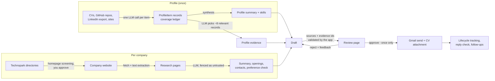
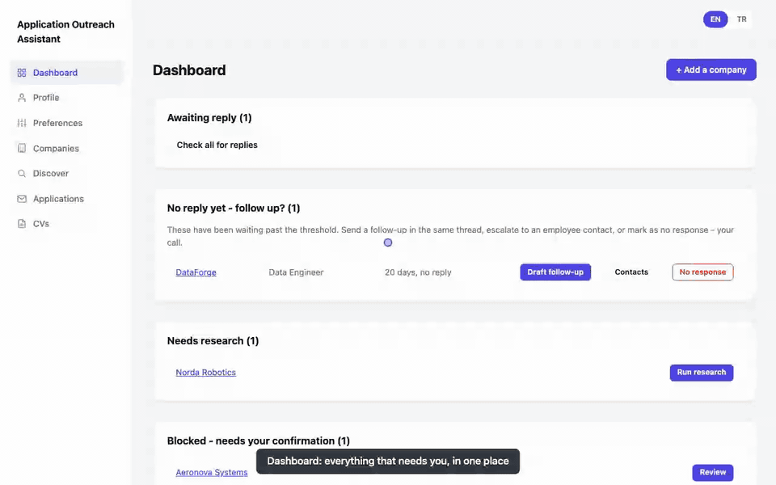

# Application Outreach Assistant

Personal tool that automates and standardizes job-application outreach: turns a
curated list of target companies into tailored, human-approved application
emails, tracks every application, and escalates to individual employees when a
company doesn't respond. Full spec in [CLAUDE.md](CLAUDE.md).

## How it works

**Problem:** cold applications to dozens of small tech companies are either
generic (and ignored) or take an evening each to research and write.
**Approach:** the app does the reading - your background once, each company's
site per application - and drafts a letter that cites both sides. You approve
every send, and the app enforces that anything it says can be traced to a
source.



FastAPI + Jinja2 UI on localhost, SQLite, a provider-agnostic LLM layer (Claude
or Gemini - a cheap model for reading, a stronger one for the letters), Gmail
API for sending.

## Demo



A walk through the real UI, in order:

1. **Dashboard** - the queues that need you.
2. **Profile and preferences** - your background with its sources, and the
   dealbreakers every company is checked against.
3. **Discover** - a technopark directory is imported, every homepage is
   screened (what they do, fit, dealbreakers with the words from their site),
   and ✓ / ✕ decide each candidate; a company without a listed website gets a
   Google search link.
4. **A company** - added by hand, its website researched right away.
5. **A draft** - AI notes on the position and CV it picked, a letter built on
   real projects, and the profile evidence it used.
6. **Feedback** - "shorter, lead with etl-pipeline" and the letter is rewritten.
7. **Approve** - sent once, with the chosen CV, then tracked.
8. **A dealbreaker** blocking drafting, the **applications** history, and the
   **follow-up** queue for companies that haven't replied.

Everything in it is fictional demo data (`*.example` addresses, a made-up
"Demo Teknokent"), recorded against a throwaway database with the LLM, Gmail
and the web stubbed out - nothing was sent. How to re-record:
[scripts/demo/README.md](scripts/demo/README.md).

## Status

The full v1 workflow (CLAUDE.md section 10) is implemented end-to-end, plus two
things section 11 had deferred - LinkedIn company research and company discovery
from technopark directories:

- **Profile**: CV/LinkedIn-export/GitHub/site ingestion, coverage ledger,
  two-stage synthesis, and an optional owner-written cover letter template that
  drafts follow the structure/tone of. A GitHub repo with a detailed README is
  read from the README alone; a brief or missing README means its source files
  are sampled too. Re-ingesting a source updates its record instead of adding a
  second one (and a failed re-run never replaces a good record). Once
  synthesized, the page shows a clean summary/skills/roles view; ingestion
  tooling collapses into "Manage sources."
- **Preferences**: hard/soft constraints, evidence-first checker. A hard match
  blocks drafting until you confirm it.
- **Companies**: adding one with a site auto-runs research - fetches home +
  careers/about/contact pages (plus a few individual job postings), writes a
  short AI summary, runs the preference check, picks up the company's LinkedIn
  page from their own social links, and auto-fills the contact email HR-first if
  it's on the site (never overwriting one you entered). There's also a **bulk
  add**: paste a whole list, one company per line in whatever loose format it's
  already in (`=`, `|`, `;`, comma or tab), preview what was parsed, then add
  them in one go with per-row status.
- **Dashboard**: the single place applications get started and reviewed - six
  action queues (needs your review / ready to draft / needs research / blocked
  by a preference match / awaiting reply / no reply yet), each with its action
  inline.
- **Company page**: applications first (with a one-line "you've contacted them
  before" note and a small expander to start another draft), then website
  research, then the LinkedIn card, then one table of people worth contacting
  that merges what the site and LinkedIn turned up - nothing becomes a `Contact`
  until you add it.
- **Profile evidence**: for each draft, a small LLM call ranks your analyzed
  background records (repos, CVs, LinkedIn export, sites) against the company and
  passes the ~8 most relevant ones into the drafting prompt, so the letter names
  real projects instead of paraphrasing your summary. Ranking by meaning rather
  than keywords matters here: company sites are mostly Turkish, records are
  English. The app only offers ids it chose, drops any others, always keeps a CV
  record, and reuses the pick on regenerate unless you exclude a record ("don't
  use in this draft") on the review page, which shows each record and whether
  the letter used it.
- **Discover**: technopark directories -> screened candidates -> the ones you
  approve join your company list. See [Discover companies](#discover-companies).
- **Drafting**: written by a stronger model than the reading tasks
  (`ANTHROPIC_DRAFT_MODEL`, Sonnet by default) - the cheap model's Turkish read
  stiff. The letter first settles the position, then what the company actually
  does, then which of your experiences and projects are genuinely similar, and
  talks about the company in plain words instead of repeating its product names.
  Evidence Rule (every company claim sourced), an "AI notes" panel
  explaining the company fit, which of your projects/skills matched, and the
  position+CV recommendation. Draft renders as an email (To/Subject/Body),
  editable in place. CV attachment is resolved case/whitespace-insensitively
  against your CV variants, with a visible warning + manual override if nothing
  matched (a CV must always be attached - see CLAUDE.md section 9). Drafting is
  refused outright when research came back empty, so the model is never asked to
  write about a blank page. The model's answer is schema-validated, and any
  source URL that isn't one of the pages research actually fetched is removed
  and shown to you.
- **Review loop**: green Approve / red Reject side by side; Reject opens a
  compact chat-style feedback box that regenerates the draft via AI. Approve is
  disabled until a recipient email and a CV are both resolved, and editing the
  draft without saving raises an "unsaved changes" badge that blocks the send
  rather than quietly mailing the older text. A draft you started by mistake can
  be discarded (before sending only - sent applications are kept as history).
  A "check before sending" box flags what to look at - length off target, a
  stock cover-letter phrase, removed sources, personal claims the model couldn't
  back - without blocking the send.
- **LinkedIn research** (optional, off by default): per company, how many people
  LinkedIn lists, what they do, whether the company still posts, what it lists
  as open, and who is worth contacting. See
  [LinkedIn research](#linkedin-research-optional).
- Gmail send with address validation, dedup and a send delay; reply checking
  (manual, bulk, and a quiet auto-check on page load); same-thread follow-ups;
  employee-contact escalation.
- EN/TR interface (cookie-based toggle), loading spinners on every
  LLM-triggering action so nothing looks frozen mid-request. One control scale
  across pages (36 px buttons/inputs, 28 px inside tables), no sideways scrolling
  down to phone width, and pages keep their scroll position after an action.
- 190 passing tests (`tests/`), including route-level end-to-end flow tests.

**To actually use it**, pick a provider in `.env` (`LLM_PROVIDER=gemini` or
`claude`) and set that provider's API key - everything that calls the LLM
(ingestion extraction, preference checks, research, drafting) needs it. Without
a key those routes fail on a friendly error page rather than doing anything
silently wrong. Gmail send/reply-check additionally need `credentials.json`
(OAuth client, see CLAUDE.md section 5) and `GMAIL_SENDER_ADDRESS`; `token.json`
is created on first send. **Publish the OAuth app** (Google Cloud Console ->
OAuth consent screen -> "In production"): while it is in "Testing", Google
expires the token after 7 days and sending and reply checks stop with
`invalid_grant` - delete `token.json` and approve again to recover.

## Setup

```bash
python3 -m venv .venv
source .venv/bin/activate
pip install -r requirements.txt

cp .env.example .env
# set LLM_PROVIDER and the matching key:
#   gemini -> GEMINI_API_KEY (Google AI Studio)
#   claude -> ANTHROPIC_API_KEY (letters use ANTHROPIC_DRAFT_MODEL, Sonnet by default)
```

## Run

```bash
source .venv/bin/activate
uvicorn app.main:app --reload --port 8000
```

Open http://127.0.0.1:8000 - localhost only, no auth (single-user tool). Use the
venv's interpreter: dependencies (including the MCP client the LinkedIn research
uses) are installed there, not in the system Python.

Tables are created automatically on first startup (`data/app.db`); schema changes
to existing tables are applied as safe, additive `ALTER TABLE` migrations in
`app/db.py` - existing data is never touched or rebuilt.

Suggested first run: **CVs** (add at least one variant) -> **Profile** (upload a
CV/LinkedIn export, ingest GitHub repos, synthesize, review/edit, optionally
paste a cover letter template) -> **Preferences** (add constraints) ->
**Discover** (import a technopark directory, screen it, approve the good fits)
or **Companies** (add one with its website - research runs automatically) ->
**Dashboard** (start the application, review the draft, approve & send).

## Discover companies

The **Discover** page turns technopark company directories into candidates you
approve one by one:

1. **Import** a directory. Five Ankara directories are built in, each read
   from its own structure (no LLM): ODTÜ Teknokent (the data file behind its
   JavaScript page), Bilkent Cyberpark (paginated cards with sector), Hacettepe
   Teknokent (sector categories -> company pages with website and email),
   OSTİM Teknopark (company pages with website and email) and Ankara
   Üniversitesi Teknokent (its sitemap -> company pages) - about 1,500
   companies together. Gazi Teknopark isn't included: its list lives inside a
   JavaScript app. Any other directory page can be added by URL with its city
   and technopark name; its text and links are read by the LLM and a website
   is only kept if the page actually links to it.
   Companies already in your list are recognised even under a legal name or a
   sister domain ("3DTİM ELEKTRONİK A.Ş." / beevision.ai = your BeeVision),
   hidden as "already in my list", and their empty city/technopark/email
   fields get filled in. Anything you rejected before is never suggested again.
   A candidate the directory lists without a website gets a "Search on Google"
   link (brand or listed name + technopark); paste the site you find and it
   goes back into the screening queue.
2. **Screen homepages** - one small LLM call per company on the main model:
   what it does in one sentence, how well it fits your target roles, whether
   the site has a careers page, and any preference conflict (e.g. defence) with
   the words on the site that triggered it. Runs one company per page refresh;
   leave the page to stop, come back to continue.
3. **Approve or reject** from a table sorted by fit. Approved companies join
   your list under their brand name (the directory's legal name goes into the
   notes), tagged with city and technopark, and wait in the dashboard's "needs
   research" queue - no research call is spent until you get to them.

## LinkedIn research (optional)

Off by default. When enabled, each company page gets a LinkedIn card: how many
people LinkedIn actually lists (not the company's own size bracket, which is a
much larger number on most company pages), a breakdown of what they do, whether
the company has posted recently, the openings LinkedIn lists next to what their
own careers page said, and the people worth contacting. Those people flow into
the same confirm-before-it-counts table as site-found contacts; LinkedIn never
exposes email addresses, so they stay un-escalatable until you fill one in.

Decision-makers don't appear on the unfiltered employees page, so research also
searches that page for each term in `LINKEDIN_PEOPLE_KEYWORDS` (`CEO,CTO,müdür,
insan kaynakları,HR,founder` by default) - the same thing as typing them into
the people tab's search box. People whose title names a different employer are
dropped. Each term costs one more page load: shorten the list to go faster, or
empty it to skip the targeted search.

The company's LinkedIn URL is picked up automatically from the LinkedIn icon on
their own website during normal research. For companies added before that
existed, the card has a paste box and a "look for it on their website" button
that re-reads just their social links - no LLM, no LinkedIn traffic.

**Use a throwaway LinkedIn account.** This drives a real browser session, which
LinkedIn's terms forbid and which can get an account restricted. That is why the
feature is opt-in, runs one company per click (never on add, never in bulk), and
only ever reads company pages - it does not message anyone or send connection
requests.

```bash
# 1. install uv (provides uvx): https://docs.astral.sh/uv/getting-started/installation/
# 2. log the throwaway account in once - the session persists under ~/.linkedin-mcp/
uvx mcp-server-linkedin@latest --login
# 3. in .env:
#    LINKEDIN_RESEARCH_ENABLED=true
```

The server is [stickerdaniel/linkedin-mcp-server](https://github.com/stickerdaniel/linkedin-mcp-server),
published as `mcp-server-linkedin` (`linkedin-mcp-server` on PyPI is an
unrelated project). Keep the `@latest` tag - LinkedIn changes its page structure
often, and a pinned version quietly starts returning empty data.

A run takes a few minutes (a real browser loading eight LinkedIn pages) and the
request blocks for that long on purpose - it is one owner-triggered action, not
a background job. If the session expires, the company page shows the error and
re-running `--login` fixes it.

## Security boundaries

This is a single-user tool meant to run on your own machine. What it assumes
and what it guards against:

- **Localhost only, no auth.** Don't expose the port; anyone who can reach it can
  send email as you.
- **Every send is human-approved, exactly once.** The send path refuses anything
  that isn't awaiting approval or that already has a send timestamp or Gmail id,
  and claims the application with a conditional update before calling Gmail, so
  a double-click or a second tab can't send twice. A sent application can't be
  edited, regenerated, or moved back to a draft state by hand.
- **Scraped text is data, not instructions.** Website and LinkedIn text is fenced
  as untrusted in every prompt, and the model is told never to follow
  instructions inside it. The app, not the model, decides which sources and
  profile records count.
- **Secrets stay local.** `.env`, `credentials.json` (Gmail OAuth client) and
  `token.json` (your Gmail token) are git-ignored and never leave the machine
  except to Google/the LLM provider.
- **URL fetching** only follows addresses you enter (and links on those sites).
  There is no private-IP/SSRF filter: with the owner as the only one entering
  URLs on their own machine, it isn't worth its complexity here - add one before
  ever exposing this to other users.
- **Uploads**: CV variants must be PDF/DOCX under 10 MB and are stored under a
  unique name, so two CVs never share or overwrite a file. The recipient sees a
  clean attachment name derived from the CV's display name.

## Test

```bash
source .venv/bin/activate
python -m pytest tests/ -v
```

LLM-dependent logic is tested against `tests/fakes.py::FakeLLMProvider` /
`SequencedLLMProvider` (canned JSON responses) - no real API key needed to run
the suite. Gmail send is monkeypatched; it is never called for real during
`pytest`. The LinkedIn MCP subprocess is never spawned - `linkedin_fetch` is
faked at the same seam as the website fetch. `tests/conftest.py` points the app
at a throwaway SQLite file before any app module is imported and forces the
LinkedIn flag off, so the suite never touches the real `data/app.db` and never
depends on your own `.env`.

## Layout

```
app/
  config.py            settings from .env (pydantic-settings)
  db.py                 SQLAlchemy engine/session, init_db(), column migrations
  models.py              entities + state machines (CLAUDE.md sections 6-7)
  main.py                 FastAPI app entrypoint, onboarding gate, error handlers
  llm/                    provider-agnostic LLM interface, Gemini + Claude (section 8)
  profile_builder/        CV/LinkedIn/GitHub/site ingestion, coverage ledger, synthesis
  preferences/             hard/soft constraint checker (section 4)
  companies/                site fetch, research workflow, bulk-list parsing,
                             LinkedIn fetch + research (sections 5, 9)
  discovery/                 technopark directory readers, homepage screening,
                               candidate import/approval
  applications/               drafting, profile-evidence retrieval, draft checks,
                               CV resolution, review/approve/reject,
                               follow-ups, reply check, escalation (section 5)
  email_send/                  Gmail OAuth2 send + reply check (sections 5, 9)
  web/                           FastAPI routes + Jinja2 templates + i18n + a
                                  little JS (spinners, bulk add, unsaved-draft guard,
                                  in-place discovery decisions, scroll restore)
scripts/
  init_db.py            manual DB init
  gmail_smoke_test.py    manual OAuth + send verification
  send_test_email.py      send a real test mail (for the reply-check flow)
  demo/                    throwaway DB + stub server used to record the demo GIF
tests/                 pytest suite (190 tests)
```
